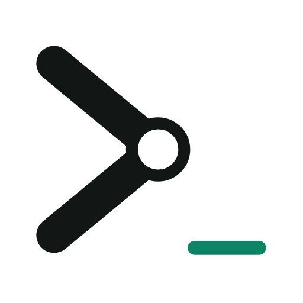
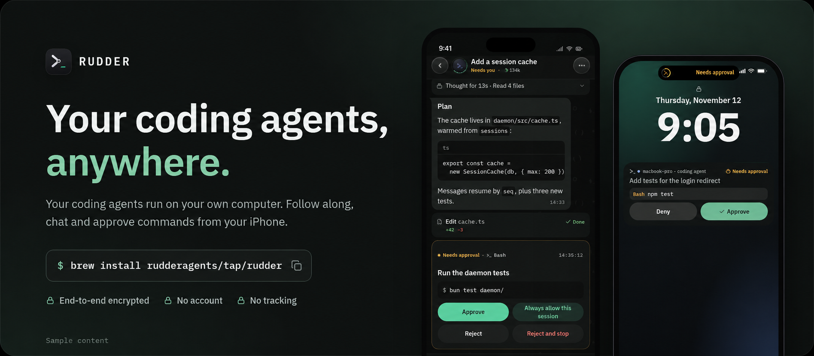
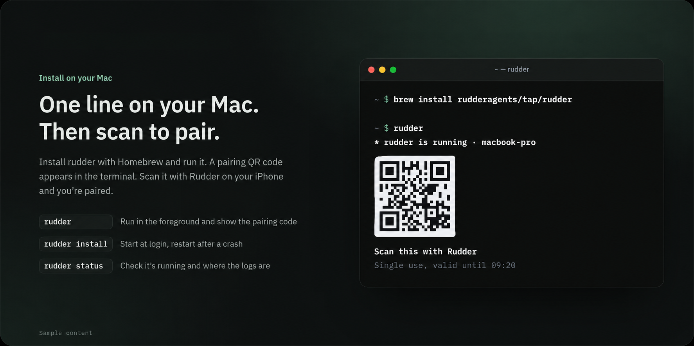
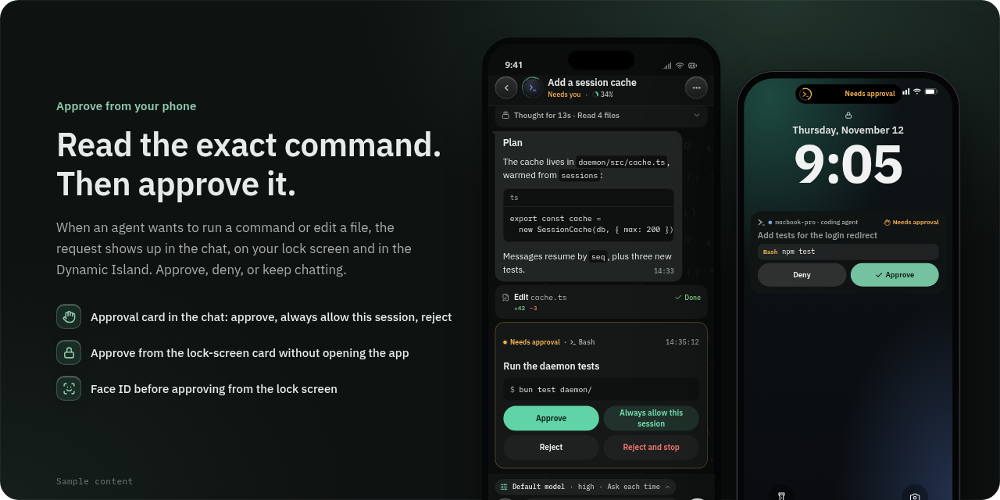
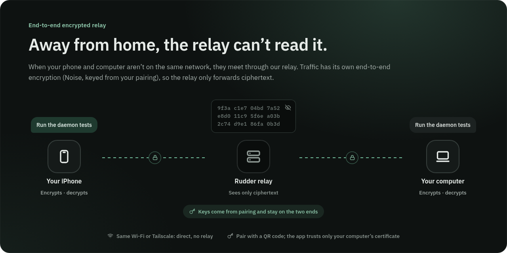

<p align="right"><b>English</b> · <a href="README.zh.md">中文</a></p>

<p align="center">
  <picture>
    <source media="(prefers-color-scheme: dark)" srcset="docs/assets/logo-dark.png">
    <source media="(prefers-color-scheme: light)" srcset="docs/assets/logo-light.png">
    
  </picture>
</p>

<h1 align="center">Rudder</h1>

<p align="center"><b>Your coding agents, anywhere.</b></p>

<p align="center">End-to-end encrypted · No account · No tracking</p>

<p align="center">
  <a href="LICENSE"></a>
  
  <a href="#install"></a>
</p>

<p align="center">
  
</p>

<p align="center">
  <a href="#install">Install</a> ·
  <a href="#how-it-works">How it works</a> ·
  <a href="#use">Use</a> ·
  <a href="#security">Security</a> ·
  <a href="#license">License</a>
</p>

Rudder lets you steer the coding agents on your Mac from your iPhone. This repository holds the part that runs on
your computer: the `rudder` daemon, plus the wire protocol the phone and the daemon speak.

The daemon starts the official coding-agent CLIs you already use, keeps your sessions on your computer, and
streams them to the phone. Your code and transcripts stay on your machine.

> **What is open and what is not.** Only the computer daemon (`daemon/`) and the protocol definitions
> (`daemon/src/protocol.ts`, `protocol/swift/` = the `RudderProtocol` Swift package) are published here, under the
> [Functional Source License 1.1 with an Apache 2.0 future license](#license). The Rudder iOS app, relay service and
> push gateway are distributed separately. See [NETWORK.md](NETWORK.md) for what the daemon sends over the network.

## Install

```sh
brew install rudderagents/tap/rudder
```

The formula installs a prebuilt, Developer ID–signed and Apple-notarized single-file binary. (homebrew-core only
accepts formulae built from source, which is why the notarized binary lives in our own tap.)

See the [Homebrew tap](https://github.com/rudderagents/homebrew-tap) for release binaries and the [Rudder website](https://rudderagents.com/) for iPhone availability.

### Supported systems

- macOS on Apple silicon (`darwin-arm64`) and Intel (`darwin-x64`). Two separate binaries are published; Homebrew
  picks the right one.
- macOS 13.0 (Ventura) or later (the binaries are built with a minimum OS version of 13.0).
- Windows builds exist in the source tree (`daemon/scripts/build-windows.sh`) but are **not released** for 1.0.

## How it works

<p align="center"></p>

Run `rudder` and scan the QR code with the Rudder app on your iPhone. The code is single-use; after a phone pairs,
the token rotates and the terminal prints the next one.

<p align="center"></p>

When an agent wants to run a command or edit a file, the request shows up in the chat, on your lock screen and in
the Dynamic Island. Approve, deny, or keep chatting.

<p align="center"></p>

On the same Wi-Fi or Tailscale tailnet the phone connects directly (`https`/`wss` on port 7749, with certificate
fingerprint pinning). When a direct connection is unavailable, supported actions can use the Rudder relay. A
pairing-derived, end-to-end encrypted Noise channel lets the relay forward ciphertext. See [NETWORK.md](NETWORK.md).

## Use

```sh
rudder               # run the daemon in this terminal and show a pairing QR code
```

Scan the code with the Rudder app on your iPhone. The code is single-use; after a phone pairs, the token rotates
and the terminal prints the next one. If a daemon is already running, `rudder` shows its code instead.

The phone reaches the daemon directly over your LAN or a Tailscale tailnet (`https`/`wss` on port 7749, a
self-signed certificate the app pins by fingerprint), or through the end-to-end encrypted Rudder relay when you
are away (see [NETWORK.md](NETWORK.md)).

Keep it running in the background:

```sh
rudder install       # register a user LaunchAgent: starts at login, restarts after a crash
rudder status        # loaded or not, pid, last exit, PATH and log files
rudder uninstall     # unload it and remove the plist; your data, pairings and the Homebrew package are kept
rudder uninstall --purge   # also delete the data directory (database, TLS key, pairings) and logs
```

| | |
|---|---|
| LaunchAgent label | `com.zysuccess.rudderd` |
| plist | `~/Library/LaunchAgents/com.zysuccess.rudderd.plist` |
| logs | `~/Library/Logs/Rudder/com.zysuccess.rudderd.out.log`, `….err.log` |
| data | `~/Library/Application Support/Rudder` (override with `RUDDER_HOME`) |

`rudder install` records your login shell's `PATH` in the plist so the LaunchAgent can find `claude`, `codex` and
the other CLIs. When installed with Homebrew, the plist runs the stable link — `/opt/homebrew/bin/rudder` on Apple
silicon, `/usr/local/bin/rudder` on Intel — never the versioned `Cellar/rudder/<version>/` path, so it keeps working
across upgrades. Running `rudder install` again (for example after an upgrade) unloads the old service and loads it
again, so the new binary takes over.

Other commands:

```sh
rudder pair                  # show a fresh pairing code for the running daemon (local machine only)
rudder devices               # list paired phones
rudder devices revoke NAME   # disconnect a phone; it must pair again
rudder relay on|off          # use the official relay or not (default: on)
rudder attach ID [--now]     # continue a phone session in this terminal with claude
rudder --version
```

Upgrade:

```sh
brew upgrade rudder
rudder install       # if you use background mode: restart the LaunchAgent on the new binary
```

To remove everything: `rudder uninstall --purge && brew uninstall rudder`. (`rudder uninstall` only removes the
LaunchAgent; it does not touch the Homebrew package.)

### Stable names

Future Rudder desktop apps rely on these names; they will not change within 1.x.

| | |
|---|---|
| LaunchAgent label | `com.zysuccess.rudderd` |
| data directory | `~/Library/Application Support/Rudder/` (override with `RUDDER_HOME`) |
| local socket | `$RUDDER_HOME/rudder.sock`, owner-only (Windows builds use the token channel file `rudder-local.json` instead) |
| default port | `7749` (override with `RUDDER_PORT`) |

Only one daemon serves a data directory. Running `rudder` while one already answers shows that daemon's fresh pairing code and exits 0. If the socket accepts connections but the daemon does not answer within 3 seconds, `rudder` exits 1 with ``rudder is already running for <dataDir> (socket <path>). Stop it first, or use `rudder status`.``

`rudder pair --json` is the scripted form of `rudder pair`. On success it prints one line on stdout and exits 0:

```json
{"url":"rudder://pair?...","expiresAt":1790000000000,"machine":"My Mac"}
```

`expiresAt` is epoch milliseconds. On failure it exits 1, prints one line on stderr and leaves stdout empty.

### Turning network features off

| Variable | Effect |
|---|---|
| `RUDDER_RELAY=off` (or `rudder relay off`) | no relay key is created and nothing connects out to the relay |
| `RUDDER_PUSH_GATEWAY=off` | no lock-screen notifications are sent |
| `RUDDER_UPDATE_CHECK=off` | no daily check for a newer Homebrew release |

With all three off, the daemon only listens for your phone on the local network.

## Verify the binary

Every release lists SHA-256 checksums for the two `.tar.gz` archives and for the `rudder` binaries inside them.

```sh
# 1. checksum of the archive you downloaded (compare with the release notes / the formula)
shasum -a 256 rudder-1.0.0-darwin-arm64.tar.gz

# 2. signature: Developer ID, hardened runtime, our Team ID
codesign --verify --strict --verbose=2 "$(which rudder)"
codesign -dv --verbose=4 "$(which rudder)" 2>&1 | grep -E 'Identifier|TeamIdentifier|Authority|flags|Timestamp'
#   Identifier=com.zysuccess.rudder
#   TeamIdentifier=RU6YBAV7ZA
#   flags=0x10000(runtime)

# 3. notarization (a bare binary cannot carry a stapled ticket; Gatekeeper checks Apple's servers)
spctl --assess -vv --type open --context context:primary-signature "$(which rudder)"
#   expected: accepted, source=Notarized Developer ID
```

The only entitlement is `com.apple.security.cs.allow-jit` ([packaging/macos/rudder.entitlements](packaging/macos/rudder.entitlements)),
which JavaScriptCore needs to run at full speed under the hardened runtime.

Each release is built from a tag in this repository; the binaries attached to the tap release
(`rudderagents/homebrew-tap`, tag `rudder-v<version>`) correspond to the source tag `v<version>` here.

## Build from source

Requires [Bun](https://bun.sh) (the daemon is developed against Bun 1.4) on macOS.

```sh
cd daemon
bun install
bun run check                 # typecheck + lint + tests
bun run src/main.ts           # same as `rudder`, from the checkout
bun run src/main.ts install   # LaunchAgent that runs this checkout

# single-file binaries in daemon/dist/, signed ad hoc (not notarized):
RUDDER_SIGN_IDENTITY=- bun run build
```

Swift protocol package:

```sh
swift test --package-path protocol/swift
```

## Contributing

See [CONTRIBUTING.md](CONTRIBUTING.md) for the contribution process and DCO sign-off.

## License

The daemon and the protocol are licensed under the **Functional Source License, Version 1.1, ALv2 Future License**
(`FSL-1.1-ALv2`, also written FSL-1.1-Apache-2.0). In short: you may use, modify and redistribute the software for any
purpose except a competing commercial product or service; two years after each version is released, that version
also becomes available under the Apache License 2.0. See [LICENSE](LICENSE) for the full terms.

The release binaries also contain the Bun runtime and the libraries it links (MIT, and LGPL for JavaScriptCore /
WebKit and tinycc); their licenses ship next to the binary in `THIRD_PARTY_NOTICES` and live in
[packaging/notices](packaging/notices).

"Rudder" and the Rudder logo are trademarks of Yu Zhu; the license does not grant rights to them.

## Security

Please report vulnerabilities privately through GitHub's private vulnerability reporting (the **Security** tab → **Report a vulnerability**) — see [SECURITY.md](SECURITY.md). Do not open
a public issue for security problems.
