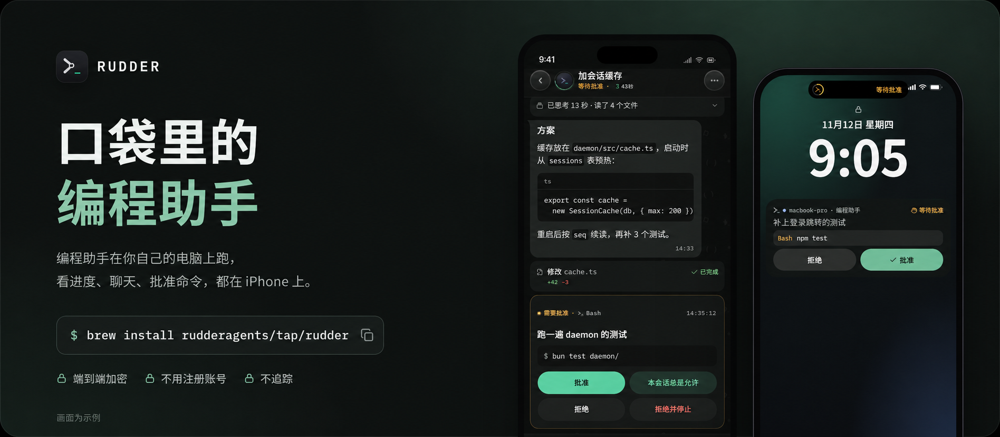
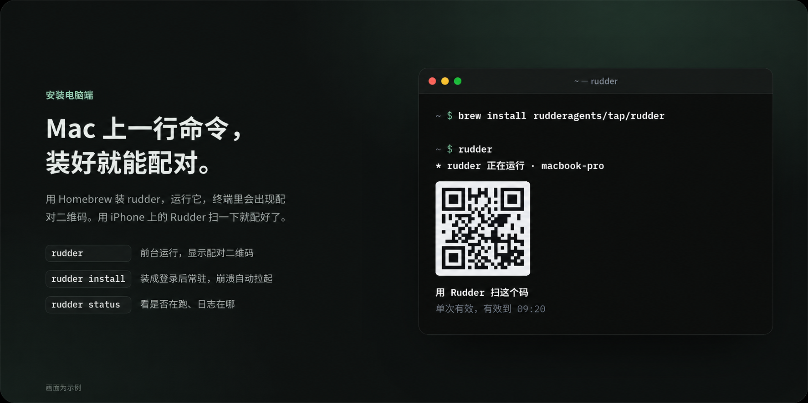
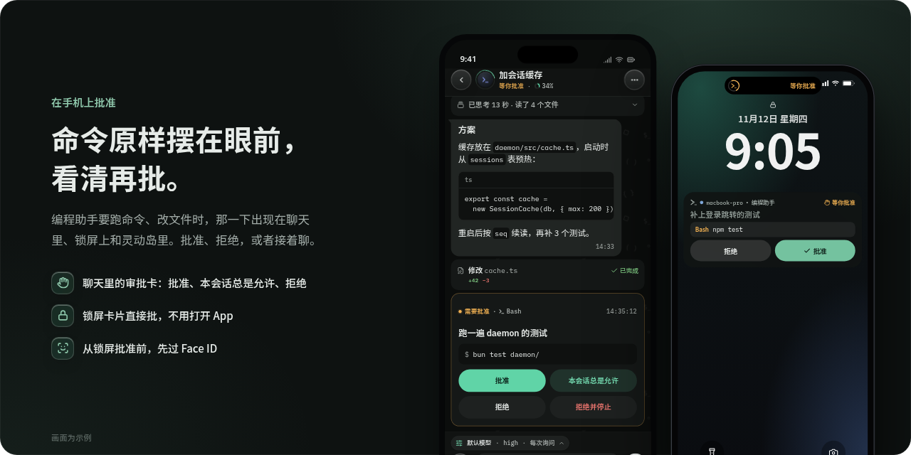
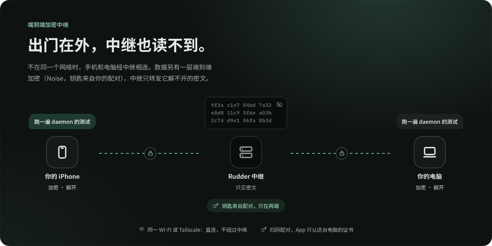

<p align="right"><a href="README.md">English</a> · <b>中文</b></p>

<p align="center">
  <picture>
    <source media="(prefers-color-scheme: dark)" srcset="docs/assets/logo-dark.png">
    <source media="(prefers-color-scheme: light)" srcset="docs/assets/logo-light.png">
    
  </picture>
</p>

<h1 align="center">Rudder</h1>

<p align="center"><b>口袋里的编程助手</b></p>

<p align="center">端到端加密 · 不用注册账号 · 不追踪</p>

<p align="center">
  <a href="LICENSE"></a>
  
  <a href="#安装"></a>
</p>

<p align="center">
  
</p>

<p align="center">
  <a href="#安装">安装</a> ·
  <a href="#工作方式">工作方式</a> ·
  <a href="#使用">使用</a> ·
  <a href="#安全">安全</a> ·
  <a href="#许可证">许可证</a>
</p>

Rudder 让你用 iPhone 操控 Mac 上的编程助手。本仓库存放跑在电脑上的那一部分——`rudder` 守护进程，以及手机与守护进程共用的通信协议。

守护进程拉起你已经在用的官方命令行编程工具，会话留在你的电脑上，再同步到手机。代码和对话记录都留在本机。

## 安装

```sh
brew install rudderagents/tap/rudder
```

安装包见 [Homebrew tap](https://github.com/rudderagents/homebrew-tap)，iPhone 版上架信息见 [Rudder 官网](https://rudderagents.com/zh/)。

formula 安装的是预先构建、经 Developer ID 签名并由 Apple 公证的单文件二进制（homebrew-core 只收从源码构建的 formula，所以公证后的二进制放在我们自己的 tap 里）。
支持 macOS 13（Ventura）或更高，Apple 芯片（`darwin-arm64`）和 Intel（`darwin-x64`）各一份二进制，Homebrew 会自动选对。源码树里有 Windows 构建脚本，但 **1.0 不发布** Windows 包。

## 工作方式

<p align="center"></p>

运行 `rudder`，用 iPhone 上的 Rudder App 扫终端里的二维码。配对码一次性有效；手机配对成功后令牌会轮换，终端会打印下一张。

<p align="center"></p>

编程助手要执行命令或改文件时，请求会出现在对话里、锁屏上和灵动岛里。批准、拒绝，或者接着聊。

<p align="center"></p>

在同一 Wi-Fi 或 Tailscale tailnet 里，手机直连电脑（`https`/`wss`，端口 7749，App 按指纹钉住自签证书）。无法直连时，支持的操作可经 Rudder 中继送达，数据另有一层端到端加密（Noise，密钥来自你的配对），中继只转发它解不开的密文。守护进程发起的每个网络连接都写在 [NETWORK.md](NETWORK.md) 里。

> **仓库范围。** 这里只公开电脑端守护进程（`daemon/`）和协议定义（`daemon/src/protocol.ts`、`protocol/swift/`，即 Swift 包 `RudderProtocol`），许可证为
> [Functional Source License 1.1，两年后转为 Apache 2.0](#许可证)。Rudder iOS App、中继服务和推送网关单独分发。守护进程的网络行为见 [NETWORK.md](NETWORK.md)。

## 使用

```sh
rudder                       # 在当前终端运行，并显示配对二维码
rudder install               # 注册用户 LaunchAgent：登录时启动，崩溃后重启
rudder status                # 是否已加载、pid、上次退出、PATH 和日志
rudder pair                  # 为正在运行的守护进程显示新的配对码（仅本机）
rudder devices               # 列出已配对的手机
rudder devices revoke NAME   # 断开某台手机；它需要重新配对
rudder relay on|off          # 是否使用官方中继（默认：开）
rudder attach ID [--now]     # 在本终端接续一个手机会话
rudder uninstall [--purge]   # 移除 LaunchAgent（--purge 同时删除数据和日志）
```

如果已经有守护进程在跑，`rudder` 会显示它的配对码，而不会再起一份。

<details>
<summary><b>后台模式、文件位置和升级</b></summary>

| | |
|---|---|
| LaunchAgent 标签 | `com.zysuccess.rudderd` |
| plist | `~/Library/LaunchAgents/com.zysuccess.rudderd.plist` |
| 日志 | `~/Library/Logs/Rudder/com.zysuccess.rudderd.out.log`、`….err.log` |
| 数据 | `~/Library/Application Support/Rudder`（可用 `RUDDER_HOME` 覆盖） |

`rudder install` 会把登录 shell 的 `PATH` 写进 plist，这样 LaunchAgent 才能找到你的命令行编程工具。用 Homebrew 安装时，plist 跑的是稳定链接（Apple 芯片上是 `/opt/homebrew/bin/rudder`，Intel 上是 `/usr/local/bin/rudder`），而不是带版本号的 `Cellar` 路径，所以升级后仍然有效。再跑一次 `rudder install` 会在当前二进制上重新加载服务。

```sh
brew upgrade rudder && rudder install                  # 升级（让后台模式切到新二进制）
rudder uninstall --purge && brew uninstall rudder      # 全部移除
```

`rudder uninstall` 只去掉 LaunchAgent；除非加 `--purge` 或执行 `brew uninstall`，数据、配对记录和 Homebrew 包都会保留。

</details>

### 固定接口

这些名称在 1.x 内保持稳定，供桌面 App 和脚本使用。

| 接口 | 固定值 |
|---|---|
| LaunchAgent 标签 | `com.zysuccess.rudderd` |
| 数据目录 | `~/Library/Application Support/Rudder/`，可用 `RUDDER_HOME` 覆盖 |
| 本机 socket | `$RUDDER_HOME/rudder.sock`，仅所有者可访问。Windows 使用 `rudder-local.json` |
| 默认端口 | `7749`，可用 `RUDDER_PORT` 覆盖 |

每个数据目录只由一个守护进程服务。已有守护进程能应答时，再运行 `rudder` 会显示新的配对码并以状态码 0 退出。若 socket 能连上但 3 秒内没有应答，命令会报错并以状态码 1 退出。

脚本可以调用 `rudder pair --json`。成功时向标准输出写一行 JSON，包含 `url`、`expiresAt`（Unix 毫秒时间戳）和 `machine`，以状态码 0 退出。失败时向标准错误写一行，标准输出为空，以状态码 1 退出。

### 关掉网络功能

| 变量 | 效果 |
|---|---|
| `RUDDER_RELAY=off`（或 `rudder relay off`） | 不创建中继密钥，也不向外连接中继 |
| `RUDDER_PUSH_GATEWAY=off` | 不发送锁屏通知 |
| `RUDDER_UPDATE_CHECK=off` | 不每日检查是否有新的 Homebrew 版本 |

三项都关掉时，守护进程只在本地网络上等候你的手机。

## 校验二进制

每次发布都会列出两个 `.tar.gz` 以及其中 `rudder` 二进制的 SHA-256。

```sh
# 1. 你下载的归档的校验和（与发布说明 / formula 比对）
shasum -a 256 rudder-1.0.0-darwin-arm64.tar.gz

# 2. 签名：Developer ID、hardened runtime、我们的 Team ID
codesign --verify --strict --verbose=2 "$(which rudder)"
codesign -dv --verbose=4 "$(which rudder)" 2>&1 | grep -E 'Identifier|TeamIdentifier|Authority|flags|Timestamp'
#   Identifier=com.zysuccess.rudder
#   TeamIdentifier=RU6YBAV7ZA
#   flags=0x10000(runtime)

# 3. 公证（裸二进制不能 staple 票据；Gatekeeper 会向 Apple 的服务器查询）
spctl --assess -vv --type open --context context:primary-signature "$(which rudder)"
#   expected: accepted, source=Notarized Developer ID
```

唯一的 entitlement 是 `com.apple.security.cs.allow-jit`（[packaging/macos/rudder.entitlements](packaging/macos/rudder.entitlements)），JavaScriptCore 在 hardened runtime 下要靠它才能全速运行。每次发布都从本仓库的 tag 构建：tap 仓（`rudderagents/homebrew-tap`，tag `rudder-v<version>`）上的二进制对应这里的源码 tag `v<version>`。

## 从源码构建

需要在 macOS 上安装 [Bun](https://bun.sh)（按 Bun 1.4 开发）。

```sh
cd daemon
bun install
bun run check                 # typecheck + lint + 测试
bun run src/main.ts           # 与 `rudder` 相同，从这份检出运行
RUDDER_SIGN_IDENTITY=- bun run build    # daemon/dist/ 下的单文件二进制，临时签名（未公证）
```

从仓库根目录测试 Swift 协议包。

```sh
swift test --package-path protocol/swift
```

## 贡献

请见 [CONTRIBUTING.md](CONTRIBUTING.md)。外来补丁需附带 Developer Certificate of Origin（`git commit -s`），并在 Apache License 2.0 下授权给本项目。

## 安全

请在本仓库的 **Security** 页选择 **Report a vulnerability** 私下提交漏洞报告。详情见 [SECURITY.md](SECURITY.md)。

## 许可证

守护进程和协议使用 **Functional Source License, Version 1.1, ALv2 Future License**
（`FSL-1.1-ALv2`，也写作 FSL-1.1-Apache-2.0）。简而言之：除用于与之竞争的商业产品或服务外，你可以为此软件做使用、修改和再分发；每个版本发布两年后，该版本同时可在 Apache License 2.0 下使用。完整条款见 [LICENSE](LICENSE)。

“Rudder” 及 Rudder 标识是 Yu Zhu 的商标；本许可证不授予商标权。

发布包随附 Bun 及其链接库的第三方许可证，见包内 `THIRD_PARTY_NOTICES` 或 [packaging/notices](packaging/notices)。

## 星标历史

[](https://www.star-history.com/#rudderagents/rudder&Date)
